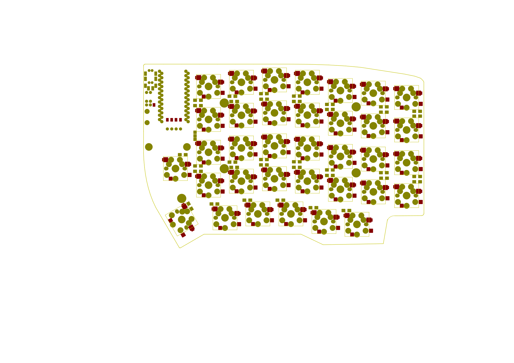

# Code70

A 70-key split mechanical keyboard (35 keys per half), designed in KiCad and derived from [Lily58 Pro](https://github.com/kata0510/Lily58).

## Features

- Reversible PCB: the same board is used for both halves, selected with jumpers.
- 35 hot-swap sockets per half (Cherry MX / Kailh low profile footprint).
- Pro Micro controller (ATmega32U4).
- 4-pin I2C OLED display.
- TRRS cable between halves.
- SOD-123 diodes, reset button and M2 mounting holes.

## Repository layout

| Folder | Contents |
|---|---|
| `pcb/` | KiCad 5 project (`Code70.pro`), schematic, board and Gerber files |
| `library/` | Footprints and the symbol cache used by the project |
| `case/` | Laser-cut template (`plantilla-corte.ai`, Adobe Illustrator) and board outline (SVG) |
| `layout/` | Key layout spreadsheet (Spanish layout, with `ñ`) |

Library paths are relative to the project (`${KIPRJMOD}/../library`), so `pcb/Code70.pro` opens without extra setup.

## Fabrication

The Gerber files in `pcb/gerber/` and `pcb/Code70_gerber.zip` were exported on 2021-02-12, and the board file was saved again on 2021-02-15. Before ordering, open `pcb/Code70.kicad_pcb` and export the Gerbers again so they match the latest board.

## Firmware

Firmware is not included yet. QMK firmware for this board must define the Code70 matrix; the Sofle keymap does not match it as-is.

## Credits and license

Code70 is released under the MIT License (see `LICENSE`). It builds on Lily58 by Naoki Katahira, which in turn builds on Helix, crkbd and Ergo42, all under the MIT License.

---

## En español

Code70 es un teclado mecánico dividido de 70 teclas (35 por mitad), diseñado en KiCad a partir de Lily58 Pro.

- **PCB reversible:** la misma placa sirve para las dos mitades; se elige con puentes (jumpers).
- **Componentes:** 35 sockets hot-swap por mitad, Pro Micro, pantalla OLED, cable TRRS y botón de reset.
- **Distribución en español:** la hoja `layout/Code70Teclas.xlsx` incluye la `ñ`.
- **Antes de fabricar:** exporta de nuevo los Gerber desde `pcb/Code70.kicad_pcb`; los incluidos son de una revisión anterior de la placa.
- **Firmware:** todavía no está incluido.

Licencia MIT. Basado en Lily58 (Naoki Katahira), que a su vez se basa en Helix, crkbd y Ergo42.
